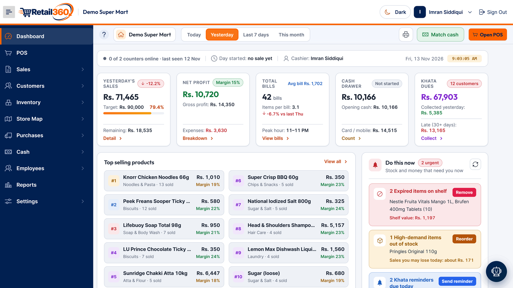
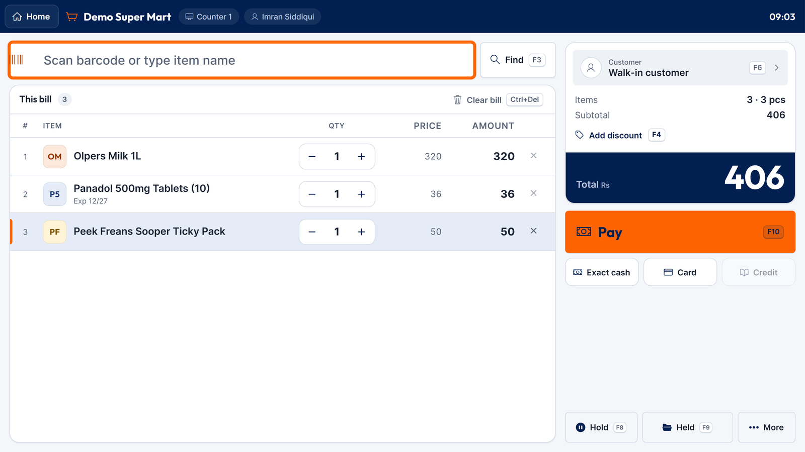
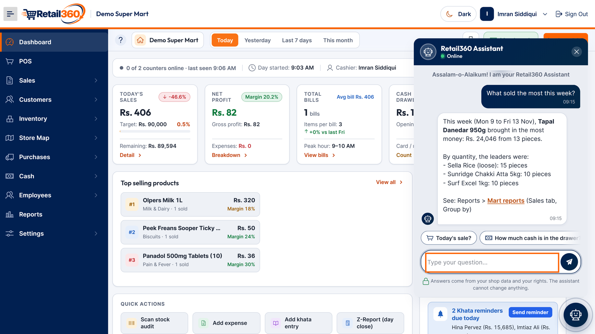
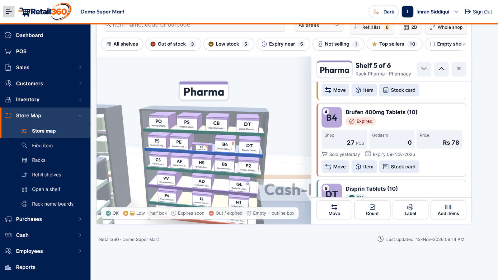
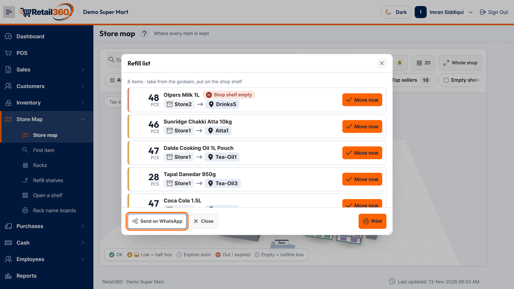
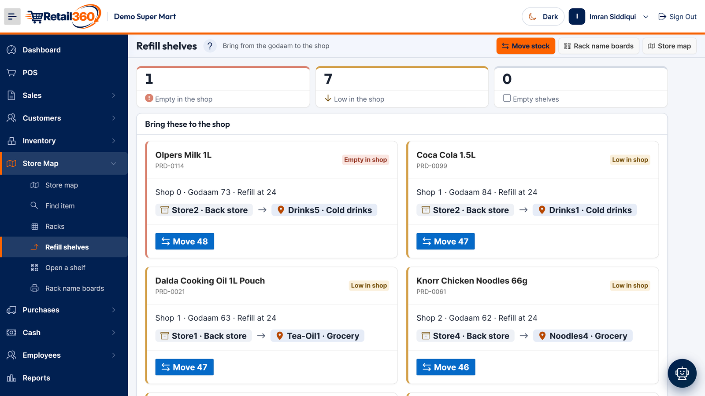

  
  
  
  
  
  

# Retail360

A point-of-sale and store app for **marts, pharmacies and grocery stores** in Pakistan.
Fast barcode billing at the counter, stock with expiry dates, a store map of racks and shelves, purchases, cash, staff salary and reports,
in one app for laptop and phone, in English and Roman Urdu, light and dark mode.

This repository is a project showcase (screens and features). The source code is private.

## Screens

From the demo mart (sample data only).

| Dashboard | POS (counter billing) |
|---|---|
|  |  |

| AI assistant | Store map (shelf view) |
|---|---|
|  |  |

| Store map: refill list | Store map: refill shelves |
|---|---|
|  |  |

## What it does

- **POS:** barcode scan or name search, keyboard shortcuts, hold and recall bills, discounts, cash / card / credit (khata), split payment, printed receipts
- **Stock:** items with expiry dates, low-stock and near-expiry alerts, stock audit by scanning, barcode label printing
- **Store map:** racks and shelves drawn as a map; find any item, see what is out of stock or expired on which shelf, refill list
- **Purchases:** supplier bills, returns, last purchase price and stock in hand while buying
- **Cash:** cash drawer per counter, day start and day close (Z-report), expenses, matching cash
- **Customers:** khata (credit) accounts, payments and reminders
- **Staff:** employees, advances and monthly salary sheet
- **Reports:** sales, profit and margin, top sellers, stock worth, expiry
- **AI assistant:** answers questions like "What sold the most this week?" from the mart's own data; read-only, and only what the user's role is allowed to see
- **Multi-counter and roles:** several counters at once; owner, manager and cashier roles with permissions

## How it is built

- **Oracle APEX** (native components) on **Oracle Database**, business rules in **PL/SQL** packages
- **Multi-tenant:** many marts on one system; every mart sees only its own data
- **Oracle Cloud (OCI)** hosting
- **AI assistant:** LLM (Claude) with read-only tools written in PL/SQL, checked against the user's shop and permissions
- **Playwright** end-to-end tests on laptop and phone sizes, English and Roman Urdu

## Contact

Fahad Asghar · Senior Oracle APEX Developer
[LinkedIn](https://www.linkedin.com/in/fahad-asghar25) · [kafacloud.com](https://kafacloud.com) · kafacloud.info@gmail.com
